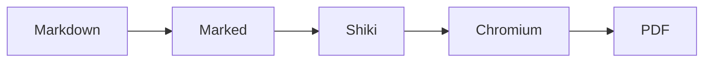

# Comprehensive GitHub Markdown Fixture

This fixture validates GitHub-like light PDF output, page flow, diagrams, alerts, tables, images, and code wrapping.

> [!NOTE]
> Notes provide useful context without interrupting the main flow.

> [!TIP]
> Tips identify a better or easier approach.

> [!IMPORTANT]
> Important details are required for success.

> [!WARNING]
> Warnings describe risks requiring attention.

> [!CAUTION]
> Cautions describe possible negative outcomes.

## GitHub-Flavoured Markdown

- [x] Task completed
- [ ] Follow-up remains
- Nested lists, **bold text**, *emphasis*, ~~strikethrough~~, and [links](https://github.com) render normally.

| Feature | Expected result | Status |
| --- | --- | --- |
| Tables | Bordered GitHub-style cells | Ready |
| Images | Resolve relative to Markdown | Ready |
| Code | Highlight and wrap | Ready |


## Highlighted Code

```typescript
interface ConversionResult {
  input: string;
  output: string;
  pages: number;
}

export function summarize(result: ConversionResult): string {
  return `Converted ${result.input} into ${result.output} across ${result.pages} pages`;
}
```

Long lines must wrap rather than clip:

```text
https://example.com/a/very/long/path/that/intentionally/continues/without/convenient/breakpoints/to/prove/that/the/pdf/renderer/wraps/content/instead/of/clipping/important/information/from/the/right/edge/of/the/page
```

## Mermaid Diagram



## Page Flow

PDF output uses A4 portrait pages and footer page numbers. No visible document header or generated table of contents appears.

### Rendering Principles

Markdown documents often combine prose, structured data, source code, local assets, and diagrams. Converter handles each content type in one pipeline while preserving readable spacing and clear hierarchy. Source remains unchanged. Output directory can differ from input directory without breaking relative image resolution.

Repeated prose ensures fixture spans multiple pages under standard A4 dimensions. Typography remains compact enough for technical documentation while retaining generous heading separation. Borders use GitHub's subtle neutral palette. Links and alert labels use semantic accent colors. Code uses Shiki theme `github-light-default`.

### More Content

1. Parse Markdown with GitHub-flavoured extensions.
2. Highlight fenced source code before browser rendering.
3. Render Mermaid blocks as SVG diagrams.
4. Resolve relative assets from source location.
5. Print HTML using Chromium's A4 PDF support.
6. Add page numbers through footer template.

This paragraph repeats key constraints for visual inspection. Long code lines cannot be clipped. Tables remain legible. Local relative images must render. Five alert types must have visible styles. Mermaid diagrams must become diagrams rather than remain code. Header stays empty. Table of contents stays absent.

This paragraph adds enough body copy to force pagination. GitHub-flavoured Markdown provides familiar semantics for engineering docs. Consistent layout supports README files, architecture notes, release plans, incident reviews, and internal technical guides. Printed output should preserve those semantics without requiring repository current directory.

This paragraph adds final pagination pressure. Portable command invocation means users can convert files from home folders, sibling projects, temporary directories, or automation workspaces. Installed package resolves runtime dependencies from itself. Input and output paths remain user-controlled.
